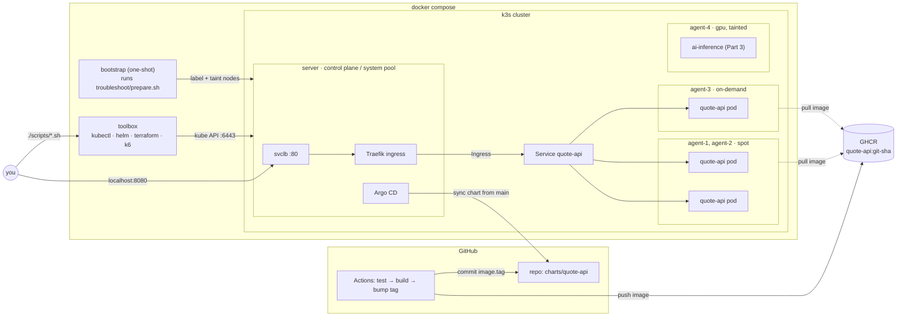
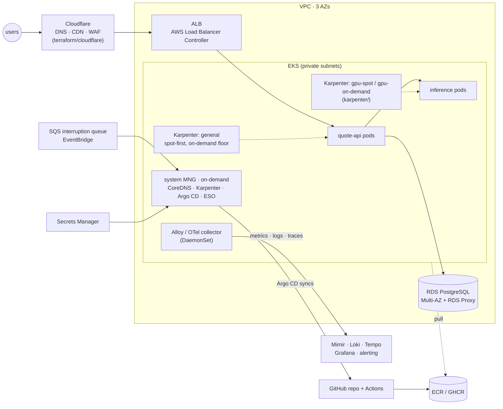

# DevOps take-home — quote-api platform

A small HTTP service shipped through a local, production-shaped platform: a
5-node k3s cluster with simulated spot / on-demand / GPU nodepools, GitOps with
Argo CD, a spot-reclaim drill, a troubleshooting exercise, and validate-only IaC
for Karpenter and Cloudflare.

- **Repository:** https://github.com/anhnt3494/elsa-devops-takehome
- **App image:** `ghcr.io/anhnt3494/quote-api:<git-sha>` — the tag currently
  deployed is in [`charts/quote-api/values.yaml`](charts/quote-api/values.yaml)
  (multi-arch amd64/arm64, public)
- **Toolbox image:** `ghcr.io/anhnt3494/devops-toolbox:1.1.0`

## Quick start

```bash
git clone https://github.com/anhnt3494/elsa-devops-takehome.git && cd elsa-devops-takehome
docker compose up -d
./scripts/run-all.sh
```

Then, from your machine:

```bash
curl http://localhost:8080/api/quote
```

`run-all.sh` waits for the cluster, deploys the app through Argo CD, runs the
spot-reclaim drill, fixes and verifies the troubleshooting namespace, and
validates the Terraform and Karpenter code. Measured on a fresh clone with no
images cached: `compose up` 2 min, `run-all.sh` 9 min (mostly image pulls); a
second `run-all.sh` on the same cluster takes about a minute. Every script is idempotent; run any of them again, or one by one.
`docker compose down -v` removes everything.

| Part | Where |
|---|---|
| 1 — service + image | [`app/`](app/), [`.github/workflows/quote-api.yml`](.github/workflows/quote-api.yml) |
| 2 — GitOps + placement + drill | [`charts/quote-api/`](charts/quote-api/), [`argocd/`](argocd/), `scripts/20-*`, `scripts/25-*` |
| 3 — troubleshooting | [`troubleshoot/fixed-app.yaml`](troubleshoot/fixed-app.yaml), [`TROUBLESHOOTING.md`](TROUBLESHOOTING.md) |
| 5 — Karpenter + Cloudflare (chosen track) | [`karpenter/`](karpenter/README.md), [`terraform/cloudflare/`](terraform/cloudflare/README.md) |
| 7 — ops questions | [`OPS-ANSWERS.md`](OPS-ANSWERS.md) |
| AI usage | [`AI-USAGE.md`](AI-USAGE.md) |

## Architecture (local)



How a change reaches the cluster: a push touching `app/` runs tests, builds a
multi-arch image tagged with the full git SHA, and a bot commit writes that tag
into `charts/quote-api/values.yaml`. Argo CD (polling every 60s) syncs the
chart from `main`. Nothing is `helm install`ed by hand except Argo CD itself.

## Architecture (production on AWS — bonus)



Same patterns as the local build: spot-first capacity with an on-demand floor,
GitOps from one repo, ingress kept off spot capacity, images pinned by digest/SHA.

## Script reference

All scripts run inside the toolbox container; started from the host they
re-exec there through `docker compose exec`.

| Script | What it does / when |
|---|---|
| `00-bootstrap.sh` | Waits for 4 Ready workers, runs `troubleshoot/prepare.sh` (unmodified). Runs automatically as the `bootstrap` compose service. |
| `20-deploy.sh` | Installs Argo CD (chart 10.10.5), registers the `quote-api` Application, waits for Synced/Healthy, prints placement, smoke-tests through the Ingress. |
| `25-reclaim-drill.sh` | Drains a spot node that runs a replica while a curl loop hits the Ingress; shows rescheduling; fails on any non-200 or if no replica is left on on-demand; always uncordons. |
| `30-troubleshoot.sh [--broken]` | Applies `troubleshoot/fixed-app.yaml` and runs `verify.sh` (→ PASS). `--broken` shows the broken state failing first. |
| `50-validate-tf.sh` | `terraform fmt -check`, `init -backend=false -lockfile=readonly`, `validate` for `terraform/cloudflare`. |
| `55-validate-karpenter.sh` | Installs the Karpenter v1.15.0 CRDs and server-side dry-runs `karpenter/` (schema + CEL rules). |
| `run-all.sh` | Waits for bootstrap, then runs every numbered script in order. |
| `show-placement.sh` | Helper: quote-api pods with the nodepool of their node. |

Argo CD UI: http://argocd.localhost:8080 — user `admin`, password:
`docker compose exec toolbox kubectl -n argocd get secret argocd-initial-admin-secret -o jsonpath='{.data.password}' | base64 -d`

## Design decisions & trade-offs

**Harness**
- **k3s directly as compose services instead of k3d.** k3d is recommended,
  but driving it from compose needs the Docker socket inside a container and
  leaves the cluster outside compose's lifecycle. Here `docker compose up`
  *is* the cluster, `down -v` removes all of it. Cost: privileged containers
  and a node count fixed in the compose file.
- **No committed cluster token.** k3s's own compose example hardcodes
  `K3S_TOKEN`; a `token-init` service generates one on first start instead.
- **Ingress and Argo CD on the control-plane node** (a stand-in for a system
  nodepool), so draining a spot node never takes the entry point down.
- Toolbox is published to GHCR; if the pull fails, compose builds it locally
  from `toolbox/` (tool downloads are checksum-verified).

**App and CI**
- Python stdlib HTTP server + `prometheus_client` only. The ~100 ms of work is
  measured in **thread CPU time**, not wall time, so it costs the same CPU when
  the pod is throttled — load tests and HPA see honest numbers.
- SIGTERM flips `/readyz` to 503 and keeps serving for 5 s before stopping, so
  rollouts and drains don't drop requests (the drill sees 0 failures).
- 74 MB Alpine image, non-root UID 10001, read-only root FS, hash-pinned
  dependency, actions pinned by commit SHA, amd64 + arm64.
- GitOps hand-off by bot commit of the image tag. Consequence when working on
  the repo: `git pull --rebase` before pushing after an app change.

**Placement (Part 2)** — in [`deployment.yaml`](charts/quote-api/templates/deployment.yaml):
required affinity to spot|on-demand (never GPU/control-plane); preferred spot
(weight 100) over on-demand (10); topology spread on `acme.io/capacity` with
`maxSkew: 1, DoNotSchedule` — two domains and three replicas force ≥1 replica
on on-demand; per-host spread is `ScheduleAnyway` so rescheduling never blocks.
- `nodeTaintsPolicy: Honor` on the capacity constraint is deliberate. I tested
  the default (`Ignore`): draining the on-demand node left a replica
  **Pending** ("didn't match pod topology spread constraints") because the
  cordoned node still counted as an empty domain. With `Honor` it reschedules
  to spot.
- Spread is only enforced at scheduling time: after the on-demand node returns
  nothing moves a replica back. The drill rebalances first; production would
  run the descheduler (`RemovePodsViolatingTopologySpreadConstraint`).
- At scale-out, `maxSkew: 1` splits replicas ~50/50 between spot and on-demand,
  which costs more than "prefer spot" suggests. A separate small on-demand
  baseline Deployment + a spot-only HPA Deployment would be cheaper; I kept one
  Deployment because the task asks for one service with min 3 replicas.

**What I cut, and why**
- **Parts 4 and 6** — one track done well; Part 5 is closest to my daily work.
  Part 1 still has a real GitHub Actions pipeline (tests, multi-arch build,
  SHA tags, GitOps bump), but no SAST gate.
- **`ci/legacy.gitlab-ci.yml` is not in the repo:** it carries AWS
  documentation example keys, which secret scanners flag, and Part 4 was not
  chosen.
- No TLS on the local ingress, Argo CD `default` project and initial admin
  secret, Argo CD installed by Helm rather than managing itself — bootstrap
  simplicity for a disposable cluster.
- No Trivy/cosign, no Prometheus stack (Part 6).

**Notes on the provided files** (treated as an imperfect handoff)
- `prepare.sh` assigns roles by node-name sort order, so agent names are
  chosen to sort predictably (`agent-1..4`).
- Pods scheduled before `prepare.sh` taints the GPU node stay there (k3s's
  `local-path-provisioner` landed on it) — `NoSchedule` does not evict.
- k3s nodes report the host's full RAM, so `broken-app.yaml`'s 16 Gi request
  schedules on a large machine and stays Pending on a small one; see
  [TROUBLESHOOTING.md](TROUBLESHOOTING.md#3-16gi-memory-request-web).
- `verify.sh` reads the deprecated `v1 Endpoints` API; it still works on
  Kubernetes 1.36 (with a warning).
- `verify.sh` gives each check 60 s. In my fresh-clone test the first
  `nginx` pull hit a connection reset, the pod went into `ImagePullBackOff`,
  and the check timed out although the fix was correct. Rather than edit the
  provided verifier, `30-troubleshoot.sh` waits for the rollouts itself (up to
  5 min) and retries `verify.sh` up to 3 times.

## Troubleshooting notes

- **Port already in use (8080 or 6443).** Pick others before starting:
  `HTTP_PORT=18080 API_PORT=16443 docker compose up -d`, then
  `curl localhost:18080/api/quote`. Scripts read the same variable.
- **Resources.** Measured: ~2.3 GB RAM at peak and ~4 GB of disk (images + the
  cluster's volumes). On Docker Desktop give the VM at least 4 GB. All nodes share the host's memory, so an
  undersized VM shows up as evicted or OOM-killed pods, not as Pending.
- **Architecture / runtime.** All images are amd64 + arm64 (Apple Silicon
  works). k3s needs privileged containers, so rootless Docker and Podman are not
  supported.
- **Network.** First start needs internet: GHCR, Docker Hub, the Argo Helm repo,
  `public.ecr.aws` (Karpenter CRDs), GitHub (Argo CD pulls the chart). Pods use
  8.8.8.8 for DNS (k3s cannot use Docker's loopback resolver); on a network
  that blocks public DNS, Argo CD cannot reach GitHub — check
  `docker compose exec toolbox kubectl -n argocd logs deploy/argocd-repo-server`.
- **Start over:** `docker compose down -v && docker compose up -d`.
